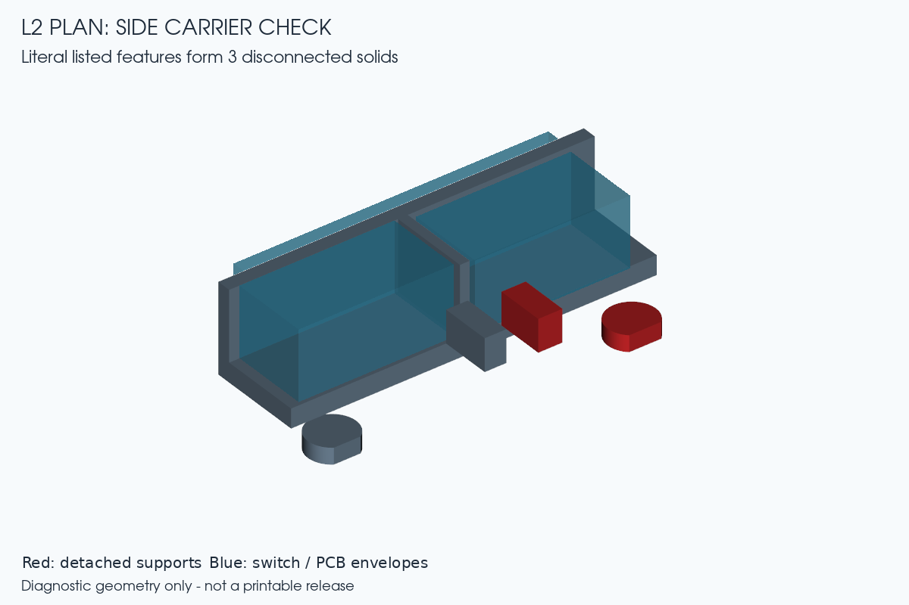
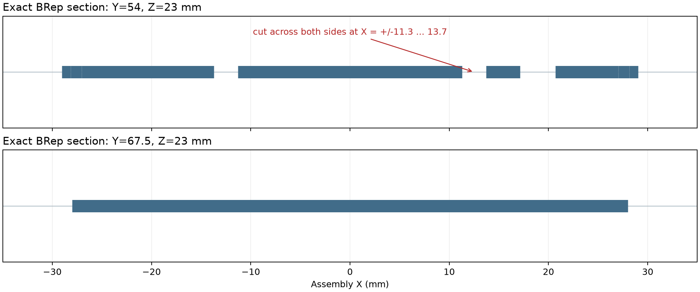

# Quietmirror L2 R1 — 独立复核工程

基于 R3.2 的轻量化指握鼠标设计复核，采用 2026-10-17 方案，复核日期为 2026-10-18。

**当前阶段：独立复核已完成，存在必须修正的问题；正式 L2 模型尚未验收。**
状态为 `REVIEW_COMPLETE_WITH_REQUIRED_CORRECTIONS / INCOMPLETE`。本仓库中的诊断 STEP 是用于展示问题的检查件，不能当作最终打印或装配模型。

## 从哪里开始

- [独立复核报告：K1–K10、有限元结果和证据边界](handoff/SECOND_CHECK.md)
- [参数修正与下一阶段建模要求](handoff/PARAMETERS_CORRECTED.md)
- [原六孔、旧侧键工具孔和滚轮钢销通道的处理](handoff/OPENINGS_RESOLUTION.md)
- [采用的完整方案](specs/Quietmirror_L2_FINAL_Plan_2026-10-17.md)
- [独立检查源码](cad/l2_r1/) · [可编辑参数](cad/l2_r1/parameters_reviewed.json)
- [复现说明与依赖](REPRODUCE.md)

## 下载与 CAD

- [本轮复核小包 ZIP（35 个文件，不含大型历史 CAD）](handoff/Quietmirror_L2_Independent_Review_2026-10-18.zip)
- [未经修正的侧键布局诊断 STEP](handoff/document_side_layout_UNCORRECTED.step)
- [R3.2 基准 FreeCAD 工程](releases/Fenrir-MiniSE-R3.2/FENRIR_MINISE_R3_2.FCStd)
- [R3.1 对照 FreeCAD 工程](releases/Fenrir-MiniSE-R3.1/FENRIR_MINISE_R3_1.FCStd)

使用 GitHub 的 **Code → Download ZIP** 可下载包含基准 CAD 的本仓库完整副本。上面的复核小包保留了发布前的原始记录；本页与复现说明是新增的发布导航。

## 已确认与仍需修正

| 检查 | 本次结果 |
|---|---|
| R3.2 九个打印件体积 | 18,506.678218 mm³；按 PA12 1.01 g/cm³ 计算为 18.691745 g。几何体积通过，不是实际打印称重 |
| 五脚贴底面 | 共面，名义 Z = 5.2 mm |
| 32 个侧面曲面采样点 | 最大坐标偏差 0.019921 mm |
| 解析梁校验 | 2.4 / 1.6 mm 网格误差约 −1.471% / −1.375%；均通过本次 <5% 门槛 |
| 整壳八工况 | 已求解并检查力与力矩平衡；只有 2 项数值在原表 ±3% 内，不能标为原作者复现通过。载荷/约束定义不足及差异详见报告 |
| 新侧键托架 | 按方案字面尺寸形成 3 个分离实体，后腿距底板 1.104 mm，必须重建连续连接 |
| 电子与机构间隙 | 侧键板到传感器耳只有 0.200 mm，另有 3 处 0.300 mm，未满足本轮 0.5 mm 目标 |
| 17.36 g 目标 | 算术预算约 17.35925 g；最终 CAD 尚未形成，不能写成实测重量 |

正式 H/D 装配模型、最终 STL/3MF、完整运动与装入检查、整壳网格收敛和实物点击/回弹均待后续完成。ATK A1 Plus 供体型号、真实 PCB 与光学尺寸仍未确认；不会把估计包络当作装配尺寸，也未擅自改为 F1 PRO。

## 检查图

## 文件范围与来源

- `cad/l2_r1/`：本轮独立检查、FEM、渲染与报告脚本。
- `reports/l2_r1/`、`views/l2_r1/`、`handoff/`：检查结果、图、诊断模型与原始复核包。
- `cad/rebuild_r*/`：基准提交中的历史建模源码，保留来源，供审阅；本轮独立脚本不导入其几何/FEM 检查函数。
- `releases/`：R3.1 / R3.2 对照 FCStd；它们是历史基准，不是本轮新完成的 L2 模型。
- `_support/`：仅收录 3 个环境/作业保护脚本，不含工具二进制、目录联接、缓存或临时 FEM 作业。

基准为 [Quietmirror/github 的固定提交 f1b1090](https://github.com/Quietmirror/github/tree/f1b1090931d717117287ea2b79c2e14ddc234937)。原仓库和 R3.3 保留，历史版本可从[原项目](https://github.com/Quietmirror/github)查看。更多工作区来源见 [PROVENANCE.md](handoff/PROVENANCE.md)。

保留 [CERN-OHL-P-2.0 许可证](LICENSE)与[原署名说明](NOTICE.md)。NOTICE 中历史参考材料位于[基准提交的 references 目录](https://github.com/Quietmirror/github/tree/f1b1090931d717117287ea2b79c2e14ddc234937/references)，第三方素材保留其原许可证。
