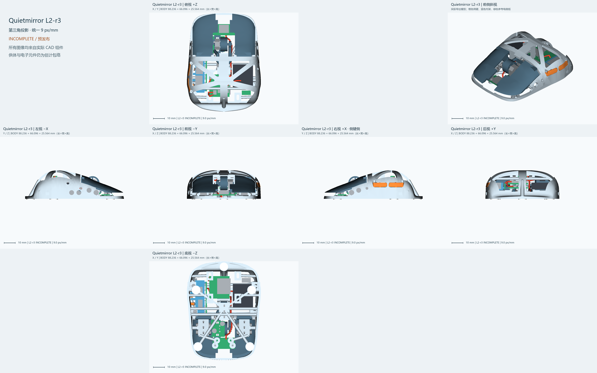

# Quietmirror L2-r3 · INCOMPLETE 预发布

右手指握轻量化鼠标的机械试验版本。当前采用2026-10-18 r3方案，延续R3.2真实模型，保留六个顶孔、五脚平台和原主键/滚轮接口。新侧键是可拆载架上的两只杠杆键。

## 下载与查看

- [H完整装配 STEP](models/L2_r3/FULL_ASSEMBLY_H.step) / [FreeCAD装配](models/L2_r3/FULL_ASSEMBLY_H.FCStd)
- [D供体占位装配](models/L2_r3/FULL_ASSEMBLY_D_PLACEHOLDER.step)
- [单盘打印3MF](models/L2_r3/L2_r3_H_ALL_PARTS_SINGLE_PLATE.3mf) / [逐件STEP与STL](models/L2_r3/parts)
- [参数化源文件](cad/l2_r3) / [复现说明](REPRODUCE.md) / [版本发布页](https://github.com/Quietmirror/Quietmirror-L2/releases/tag/L2-r3)
- [当前方案原文](specs/Quietmirror_L2_r3_FINAL_Build_and_Release_2026-10-18.md) / [独立复核](handoff/l2_r3/SECOND_CHECK.md) / [干涉报告](handoff/l2_r3/INTERFERENCE_REPORT.md)

BODY包围盒约88.236×66.096×25.564mm；最高Z30.564、外缘最低Z5.0。沿用已有基准，没有根据近似AR手长再次等比放大。装配脚贴0.8mm时垫面Z4.4，BODY最高点离垫约26.164mm。

打印件CAD体积17138.856mm³，PA12密度1.01时约17.310g。真实PLA切片耗材35.91g、时间4h 50m 28s。支撑、填充和材料差异见[核算](handoff/l2_r3/FINAL_ACCOUNTING.md)。

## 验收状态

| 项目 | 状态 | 说明 |
|---|---|---|
| G1 | PASS | 8 个打印件；CAD 单实体、自相交和封闭网格见 solids.json |
| G2 | INCOMPLETE | 打印件 28/28 对；穿模 0 对；不足目标间隙 1 对 |
| G3 | INCOMPLETE | 最终装配包络检查 248 对，其中 3 项未满足通用阈值；作者 62 项原始证据未提供 |
| G4 | INCOMPLETE | O3 贯通：True；原六孔多边形保留，最终曲面边界等价性未完整证明 |
| G5 | INCOMPLETE | 5/5 组打印件运动穿模记录 0；微动壳体/滚轮随动组件 0；运动最小间隙曲线未认证 |
| G6 | INCOMPLETE | Ø2钢销顶部探针已检查；载架直线上装最大重叠 212.250 mm³，此路径不能使用，倾斜装入未证明 |
| G7 | INCOMPLETE | H 为估计包络；D 假设板 1 处相交，不能宣称真实供体适配 |
| G8 | 3D_FEM_BLOCKED | 整壳迭代求解在615.3秒后因系统可用内存低于512MiB被保护器中止（任务峰值0.471GiB，未触及4GiB上限）；三档刚度比较未完成，小梁误差−1.635%不能替代整壳结论。 |
| G9 | INCOMPLETE | S1/S2/S3/S5/S6/S9 提供相应证据；S4 实际按压力、S7 预紧/托架应力和 S8 刚度未完成认证 |
| G10 | PASS_CAD_ESTIMATE | CAD 17138.856 mm³；PA12 密度 1.01 时 17.310 g；切片 35.91 g |
| G11 | UNVERIFIED | 键帽/垫片对壳体包络的行程干涉记录 0；实物微动、PET 调整和通断未测 |

本版仍需解决报告中的间隙/运动/侧键调节问题，三档刚度及实物功能未认证。H电子件是估计包络；D仍是用户所称ATK A1 Plus未确认供体。PAW3950不代表统一主板；1k无线、宏、LOD、充电和12h续航均未被CAD验证。

## 设计思路与试验

以连续指肚接触面和原有夹持带为外形约束，减重集中在原开放骨架、主键背面和滚轮。侧键隐藏传力筋与键帽曲面相接，压盘、止挡、卡舌和钢销分别承担触发、限位及定位；功能配合和一般避让间隙分开检查。

打印后记录握宽、顶掌、手指拖地、滚轮和侧键触达、抬鼠稳定性。装入钢销/微动后再评估按键动作，不用未通电塑料件代替真实点击与回弹试验。

## 历史和许可

[r2复核](handoff/l2_r2/README.md)、[r1复核](cad/l2_r1/README.md)、原cad/rebuild_r3_2和releases目录均保留。新CAD/文档延续本项目CERN-OHL-P-2.0；参考来源与署名见[NOTICE](NOTICE.md)。本版没有引入商业厂商CAD。
