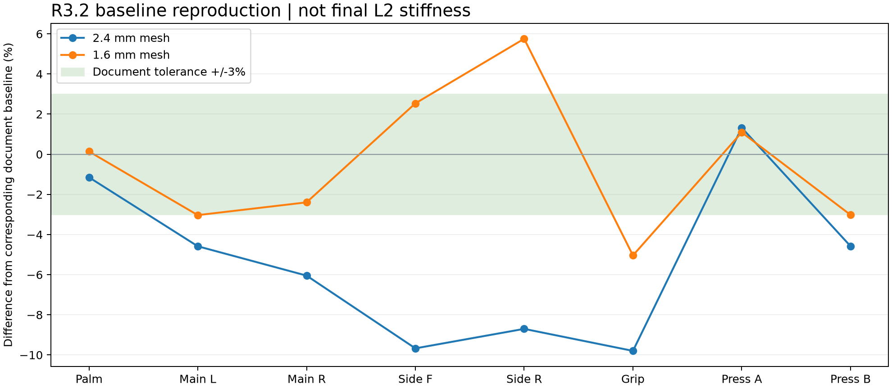
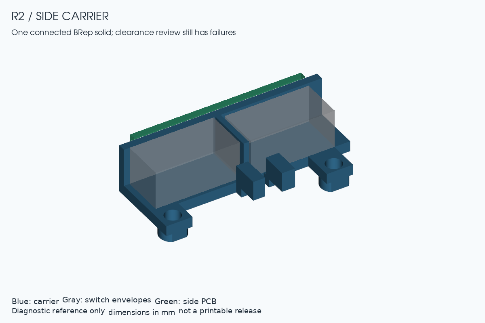
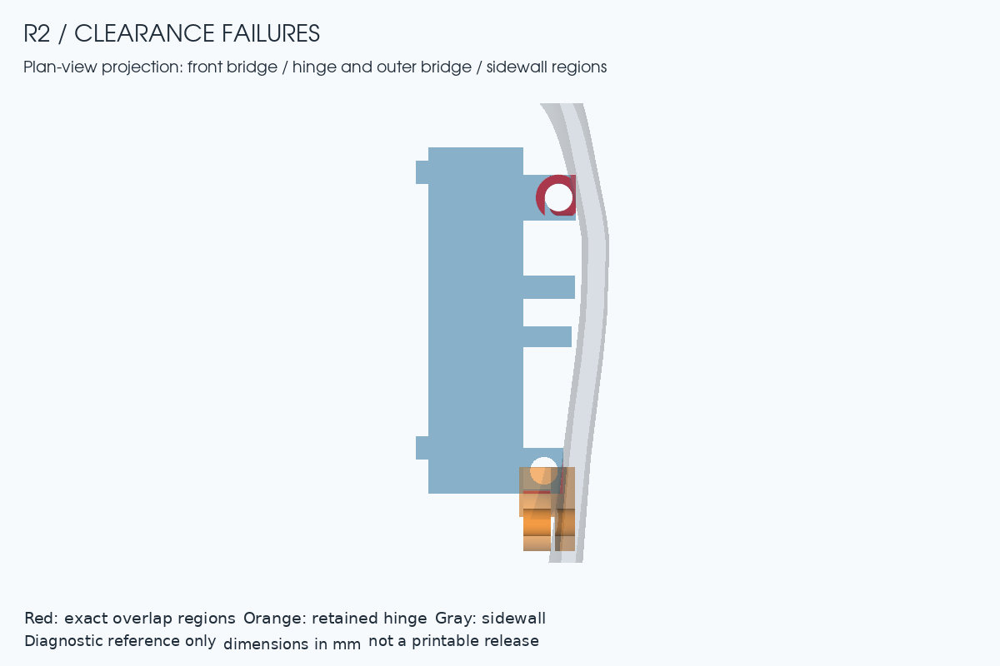
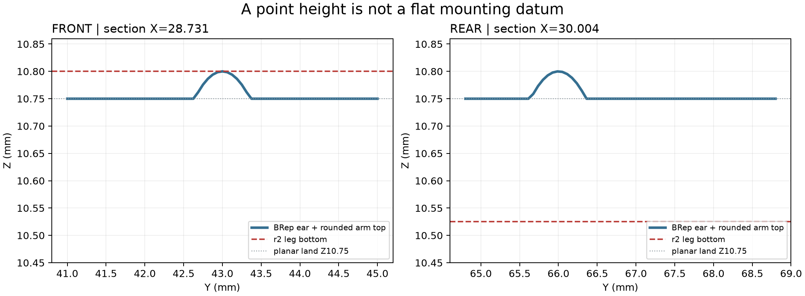

# Quietmirror L2 r2：独立复核

日期：2026-10-18。**r2 已替代现行方案；本轮复核完成，但全部前置条件未通过，最终模型状态仍为 INCOMPLETE。**

执行范围是用户确认的“替代现有方案，继续独立复核修正项”。当前[方案原文](../../specs/Quietmirror_L2_FINAL_Plan_2026-10-17.md)保留附件内容，已确认的错误和实施约束写入[修正记录](PARAMETERS_CORRECTED.md)，不将原文结论当成复核证据。r1 方案、诊断件、报告、旧压缩包和 R3.2/R3.3 均保留。本轮没有修改生产 BODY 或既有装配文件。

复核只读指定 R3.2 STEP、元数据和源码；几何与 FEM 程序没有导入方案作者的生成/求解函数。复用的是上轮由本项目独立写出的解析、求解器输入和结果读取代码。源代码见 [cad/l2_r2](../../cad/l2_r2/)，保留原[许可证](../../LICENSE)和[署名](../../NOTICE.md)。

## K1–K10

| 项目 | 本文值 / 目标 | 复核值 / 偏差 | 结论 |
|---|---|---|---|
| K1 九件体积 | 18506.678 mm³，±0.5 | 引用 r1：18506.678218；差 +0.000218 | 通过，基准未改 |
| K2 解析梁 | 误差 <5% | 引用同一独立求解链 r1：−1.471% / −1.375% | 通过；不是实物试验 |
| K3 八个基线 | 2.4 / 1.6 mm 与原表 ±3% | 2.4 mm 2/8；1.6 mm 4/8 在容差内 | **未通过复现门槛**；三档均实际求解，力/力矩平衡通过 |
| K4 Y54 断口 | X≈±11.3–13.7 | 引用 r1 的 BRep 截线 | 已确认；仅删除外臂，保留滚轮枢纽 |
| K5 内部组 | 每组说明保留/删除/加强 | 重新分解 12 组；逐组处理见下 | 分类完成；未把小组误当悬浮件删除 |
| K6 开口 | O1/O2/O4 回填，O3 保留，PH1/PH2 更新 | 与 r1 来源证据一致；O1/O2/O4=25.96049/16.69565/2.14302 mm³ | 修订正确；源码层重建后的验收待做 |
| K7 母面 X | ±0.05 | 引用 r1 32点，最大0.01992 | 通过 |
| K8 力比/偏心/转角 | 距铰点 L/4；Y0/Z−0.9 | SF 1.73554、SR 1.74803；6.56243°/6.20627° | 算术和定义通过；实际触发/止挡未证实 |
| K9 单实体、接触、间隙 | 1实体；固定非接触处≥0.5 | 托架1个有效实体；仍有桥/壁/铰座冲突；后腿嵌入保留 PCB 耳 1.266940 mm³ | **不通过**，见下 |
| K10 质量 | 17.42 g预算，最终以CAD实测 | 合计−1254.3 mm³ → 17.424902 g | 算术通过；最终整鼠CAD质量待测 |

引用证据：[r1 体积](../../reports/l2_r1/K1_volume.json)、[梁2.4](../../reports/l2_r1/K2_beam_2.4.json)、[梁1.6](../../reports/l2_r1/K2_beam_1.6.json)、[横梁截面](../../reports/l2_r1/K4_K5_cross_tie_sections.json)、[孔来源](../../reports/l2_r1/K6_source_openings.json)。这些均对应不变的 R3.2，不能移作未来 L2 验收。

## K3：按 r2 选面重新计算

单位 N/mm；每格为“文档 / 复核”。E=1500 MPa，ν=0.35；五脚 Uz 和三个面内约束，夹持等效合力 F=4 N，k=F²/(f·u)。主键根区已改为 Y35–42 / X6–24 及镜像；不再沿用 r1 较小载荷区。载荷、选面面积/中心和约束点均写入 JSON。

| 工况 | 2.4 mm k | 差异 | 1.6 mm k | 差异 |
|---|---:|---:|---:|---:|
| palm_down_20N | 105.64 / 104.42677 | -1.148% | 105.04 / 105.18540 | +0.138% |
| left_main_root_down_5N | 24.95 / 23.80600 | -4.585% | 24.47 / 23.72788 | -3.033% |
| right_main_root_down_5N | 24.28 / 22.81176 | -6.047% | 23.93 / 23.35656 | -2.396% |
| side_1_switch_fence_inward_5N | 34.47 / 31.13572 | -9.673% | 32.81 / 33.64243 | +2.537% |
| side_2_switch_fence_inward_5N | 29.37 / 26.81427 | -8.702% | 27.38 / 28.95565 | +5.755% |
| LC3_squeeze_2x2N | 496.43 / 447.78635 | -9.799% | 497.99 / 472.87906 | -5.042% |
| press_A_d16 | 62.21 / 63.03223 | +1.322% | 61.77 / 62.44460 | +1.092% |
| press_B_d16 | 56.21 / 53.63521 | -4.581% | 55.31 / 53.63921 | -3.021% |

| 网格 mm | 节点 | C3D10 单元 | 网格积分体积 mm³ | 对 BRep 的体积差 |
|---:|---:|---:|---:|---:|
| 2.4 | 84309 | 45780 | 12298.433 | -3.931% |
| 2.0 | 99442 | 53913 | 12407.088 | -3.083% |
| 1.6 | 129775 | 70571 | 12546.927 | -1.990% |

最近两档刚度最大变化为 **6.086%**，最细独立网格体积仍比BRep小约1.99%，所以曲面近似与局部收敛问题尚未消除。**这些结果不足以断定作者原表算错**。具体各工况见 [网格摘要](../../reports/l2_r2/K3_mesh_summary.json)。这是未改 R3.2 的复现和敏感性检查，没有求解最终 L2，也没有重新构造 P0/P1/P7。不能将其解释为“最终 L2 不够强”或“所有轻量化方案不可行”。

还没有取得方案引用的 `fem3d/fem_variants.py`、`l2_repo_scan/`、作者原网格和求解输入。文档给出的 1.6 mm 基线有307796节点，独立同名网格实际129775节点，故“同为1.6 mm”不等于同一离散化。使用直中边 C3D10 避开上轮曲面二次网格负雅可比；其均布牵引在仿射三角面上等价于二次形函数积分（角节点权重0，中边各A/3）。屋顶选面用明确的竖向残差<0.35，侧壁用超椭圆水平残差<0.35；后者不能冒充精确母面法向距离。应把作者的具体选面与网格配置补成可重放输入，或在统一、已收敛的独立流程下重新建立基线，不能靠改材料模量或挑载荷区凑数。

每档8工况均成功结束且平衡通过。原始 `.geo/.inp/.dat/.sta` 和求解日志保存在 `_support/work/fem_r2/`；程序、完整数值摘要和守护日志随本轮交付。内存上限4 GiB、单线程、串行；未修改系统设置。

## K5：12个内部连通组逐组处置

集合定义为“原 BODY 与独立复原的母壳内腔相交”。**12组是去除蒙皮后的几何区域，原始 BODY 本身仍是一个实体。**

| 组 | 几何名称 | mm³ | 处理 |
|---:|---|---:|---|
| 1 | lower_chassis_and_old_side_seats | 4891.72596 | MIXED: retain feet/struts/USB/sensor interfaces; remove only source-defined old side seats |
| 2 | Y54_arms_and_wheel_hub | 431.38075 | MIXED: remove Y54 outer arms only; retain central wheel hub and pin path |
| 3 | Y67_5_cross_tie | 215.93588 | KEEP: rear cross-tie and its shell load path |
| 4 | positive_X_inner_main_hinge | 155.11770 | KEEP |
| 5 | negative_X_inner_main_hinge | 151.21813 | KEEP |
| 6 | rear_negative_X_mount_bridge | 143.00583 | KEEP |
| 7 | positive_X_outer_main_hinge | 77.90425 | KEEP |
| 8 | negative_X_outer_main_hinge | 74.00467 | KEEP |
| 9 | rear_center_support_segment_A | 26.35357 | KEEP |
| 10 | rear_foot_segment_B | 16.18713 | KEEP |
| 11 | rear_foot_segment_C | 6.47174 | KEEP |
| 12 | rear_center_support_segment_D | 1.96850 | KEEP |

第1组同时含要保留的脚贴、底筋、接口与要删除的旧侧键座，不能整组删除。第2组只能取消 Y54 外臂的生成，保留 X±6/Y47–55 的滚轮枢纽和钢销通路。第9–12组与按原参数独立构造的后中脚/支撑参考几何的交集占比均约100%，应保留；不应以体积小为由清除。所有组的包围盒、有效性和重合比例见 [K5 JSON](../../reports/l2_r2/K5_r2_disposition.json)。最终变更后的单实体和网格仍需重验。

## K9：连接恢复，但装配门槛尚未通过

r2只给出了连接桥的截面和范围，未给定完整轮廓。本轮明确采用“桥以支腿Y为中心、宽4、厚1.6”，另加下包0.3的连接环与两个PCB座，作为可复查的具体展开；它是一个**可复现的反例，不表示所有满足r2文字的桥都必然冲突**。原文明确给定的腿径、中心、削平面和Z范围另行独立核对。

导出的托架重新导入后为 **1个有效BRep实体**；10处连接均有正体积搭接。外延、桥、连接环、PCB座的净增量为65.890 mm³，接近+65预算。未开完整窗/端子槽的诊断托架为758.192 mm³，**不能作为最终质量**。

| 对象 | 最小间隙 mm | 相交 mm³ | 对0.5门槛 |
|---|---:|---:|---|
| SF_stop ↔ SF_switch | 0.50000 | 0.000000 | 通过 |
| SR_stop ↔ SR_switch | 0.50000 | 0.000000 | 通过 |
| SF_switch ↔ main_outer_hinge | 0.50000 | 0.000000 | 通过 |
| SIDE_IO_PCB ↔ sensor_tab | 0.50000 | 0.000000 | 通过 |
| rear_leg ↔ rear_foot_strut | 0.54002 | 0.000000 | 通过 |
| front_bridge ↔ main_outer_hinge | 0.00000 | 0.559473 | 不通过 |
| front_legs ↔ low_mother_skin | 0.05851 | 0.000000 | 不通过 |
| front_bridges ↔ low_mother_skin | 0.00000 | 0.276488 | 不通过 |
| extension_1 ↔ switch_1 | 0.20000 | 0.000000 | 不通过 |
| rear_legs ↔ low_mother_skin | 0.00000 | 0.008711 | 不通过 |
| rear_bridges ↔ low_mother_skin | 0.00000 | 0.505545 | 不通过 |
| extension_2 ↔ switch_2 | 0.00000 | 0.000000 | 不通过 |

低侧壁参考是原母壳的 Z9–14.5 部分，符合本版低夹持带连续封闭的要求；不是把已删除旧座误算为侧壁。整托架与该参考相交约0.790744 mm³。整托架与未删除旧座的R3.2相交52.2284 mm³、PCB相交5.1062 mm³仅作环境提示，**不作为新L2的最终穿模结论**。

新增详细检查：前腿、前下包连接环到原主键铰座也不足0.5；后微动与后挡墙仍相隔0.5，需定义反力支撑，不能用未定的焊脚刚度替代。微动坐底和PCB座接触没有实体穿模，但应列入有意接触清单；原文“全部外延离微动≥0.5”与当前底面连接做法不能同时按字面验收。

### 安装耳：不能用一个点的高度定义整面贴合

独立按归档源码重新构造了通用PCB耳，并与实际 BODY 求交：两只参考耳在 BODY 之外的体积均为0。源码是7.6×7.6×2.5盒体、中心Z9.5，加半径1.3的圆弧连接筋；因此平面承台为 **Z10.75**，筋冠最高 **Z10.80**。后耳中心Y66.0，而r2后腿中心Y66.8，必须区分。

- 前腿底面Z10.80：无实体穿模，但只触及圆弧筋最高处，其余平面名义悬空0.05；不是整面承压。
- 后腿底面Z10.525：扣除本轮名义Ø2.4通孔后，仍与保留的PCB耳相交 **1.266940 mm³**，超出0.001门槛。这一材料不是应删除的旧侧键座。
- 仅把两腿都抬到Z10.80可消除这类高度侵入，但仍不能证明承压面积和预紧合格。应定义贴合耳平面的支承/带让位凹面的转接件，保留旧PCB耳，再检查完整底面与螺栓受力。
- 腿高应按 `12.1 − 实际转接件顶面Z` 计算。若在10.80上叠1.6厚转接件，顶部12.40，已高于底板下表面12.10达0.30；不能只写“M2加长1.6”就算叠装闭合。连腿正高度也要求该叠装厚度<1.30，合理承力厚度还会收紧这个范围。

详细证据：[完整底面接触](../../reports/l2_r2/K9_r2_contact_audit.json)、[原始局部面探测](../../reports/l2_r2/DATUM_and_stack.json)。后者保留文档名义高度以便对照，不代表这些高度已被采纳为正确安装面。

## K8、底面与质量边界

“距铰点L/4”的SF/SR力比为1.735537/1.748031；若从靠铰链的键帽边缘量L/4，则为2.359551/2.336842。Y偏心为0，Z偏心为−0.9。刚体绕竖轴转动的内移量含 `dx·(1−cosθ)+|dy|·sin|θ|`，纯Y估计只在dx=0时严格成立；实际铰轴X/Z、推杆X及微动FP/OP/TTP未定，不能输出实物触发角。5 N反力与0.9 mm的Z偏心对应4.5 N·mm横向弯矩，后续S7须计入，不能只核算平面杠杆比。

实际外缘朝下平面为Z5.0，面积428.524373 mm²。五脚粘贴面继续Z5.2；默认0.8脚贴对应地面Z4.4，外缘净空0.6，算术通过。要求外缘净空≥0.5意味着脚贴厚度≥0.7。镜头光学高度仍须绑定真实镜头基准和脚贴，3.1只是估计。

预算合计为−1254.3 mm³（文档−1255是取整），PA12 ρ=0.00101 g/mm³，约17.424902 g。它不包含已验证的最终窗槽、支承和所有修正体积，不能标注成品重量或切片估重。

本轮不确认电子实物兼容性：H方案是PAW3950目标；D方案保持用户最初命名“ATK A1 Plus”待确认，不采纳附件“用户原写A1 Pro”的历史描述，不替换成F1 PRO。宏、无线1K、DPI、LOD和12小时续航仍属于主板/固件/接收器/电池的后续功能验证。

## 下一阶段入口

先落实[参数修正记录](PARAMETERS_CORRECTED.md)，再做生产几何。正式H/D模型、微动与钢销装入、全行程运动、最终材料/切片质量、S1–S9和最终打印文件仍未完成。本轮完成的是独立复核，不把诊断STEP标为最终可打印鼠标。
