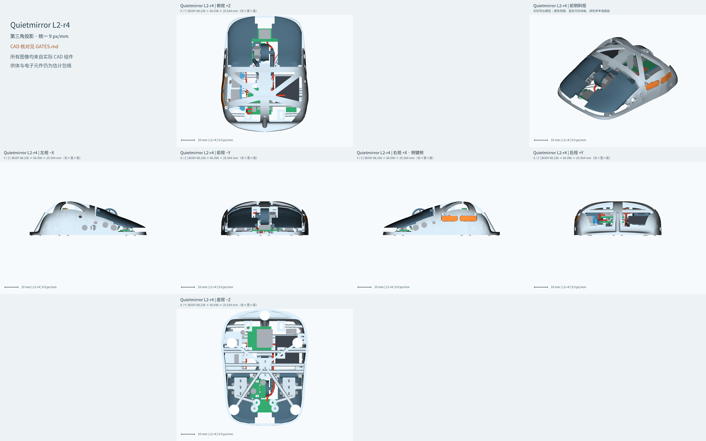

# Quietmirror L2-r4

**CAD_COMPLETE / HARDWARE_PENDING**

右手指握轻量鼠标的参数化机械设计。所有数值都区分CAD、有限离散验证和真实硬件验证；未知供体/主板/镜头参数保持明确估计。

- [设计思路与版本修正](DESIGN_RATIONALE.md)
- [门槛总表](GATES.md) / [完整JSON](FINAL_ACCOUNTING.json)
- [干涉复核](INTERFERENCE_REPORT.md) / [装配顺序](ASSEMBLY_SEQUENCE.md)
- [结构模拟与差异调查](INTERNAL_COMPONENTS_SIMULATION.md) / [切片报告](SLICE_REPORT.md)
- [可编辑源码](../../cad/l2_r4) / [完整模型与打印件](../../models/L2_r4)
- [所有调整记录](TUNING_LOG.md)

## 试握与装配反馈

依次记录夹持宽度、是否顶掌、无名指/小指是否拖地、主键/侧键/滚轮触达、抬鼠稳定性、侧键是否误触、轮轴是否松旷、支撑清理与孔销装配情况。先确认外形与刚性，再对实物开关进行贴膜调整和触发验证。

## 硬件待验证

1. 实物侧键：贴膜调整、通断测试、手感
2. 实测按压力
3. D2F-01F 实物的 FP / OP / TTP
4. PAW3950 实际镜头高度
5. D 方案供体型号确认和主板测绘（DONOR_PENDING）
6. 无线、续航、DPI、宏等功能验证
7. 打印实物的称重和试装
