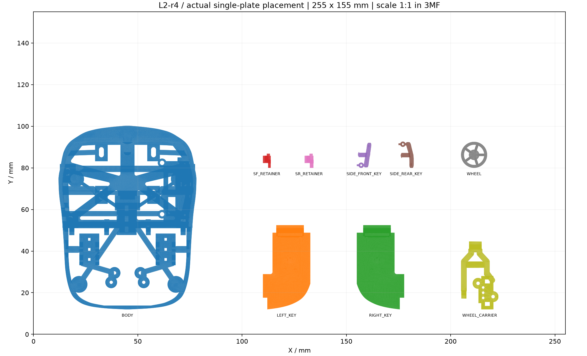

# L2-r4 真实切片报告

状态：REAL_SLICE_ESTIMATE_NOT_PRINTER_CERTIFIED。PrusaSlicer 2.9.6，PLA密度1.24g/cm³，0.4mm喷嘴、0.2mm层高，原尺寸不缩放，255×155mm参考床，organic支撑只从打印床起。

CAD聚合物体积：17619.919mm³；按PA12 1.01g/cm³：17.796g；实心PLA密度估计：21.849g。

真实单盘切片耗材：36.04g；时间：5h 18m 13s。上述数值不包含电池、主板、钢销、螺钉等实际整机质量。

| 件名 | 绕X | 绕Y | 实际切片质量g | 实际切片时长 | 消息 |
| --- | --- | --- | --- | --- | --- |
| BODY | 0 | 0 | 25.29 | 3h 38m 4s | 未返回警告 |
| LEFT_KEY | 0 | 0 | 3.55 | 29m 32s | 未返回警告 |
| RIGHT_KEY | 0 | 0 | 3.61 | 30m 10s | 未返回警告 |
| SF_RETAINER | 90 | 0 | 0.24 | 4m 54s | 未返回警告 |
| SIDE_FRONT_KEY | 0 | 0 | 0.15 | 2m 38s | 未返回警告 |
| SIDE_REAR_KEY | 0 | 0 | 0.16 | 2m 43s | 未返回警告 |
| SR_RETAINER | 90 | 0 | 0.36 | 7m 0s | 未返回警告 |
| WHEEL | 0 | 90 | 1.13 | 14m 26s | 未返回警告 |
| WHEEL_CARRIER | 0 | 0 | 1.53 | 15m 21s | 未返回警告 |

BODY朝向为脚贴面向下；实际最下缘Z=5.0，脚贴粘贴面Z=5.2，所以排盘时最低边缘先落床，脚贴面比床面高0.2mm。这个首层细节保留原底部几何，实物试印时须核对粘贴面平整度及支撑清理。内部Z12.1附近横隔板由底部开口伸入的有机支撑承托。左右键和侧键保留装配坐标朝向；挡板绕X90°以前Y端落床，滚轮绕Y90°以轴线垂直打印床。具体支撑耗材和范围由真实G-code类型统计，不将“可切片”当作实物强度或支撑可拆证明。

最小排盘包围矩形间距：13.033mm。单盘3MF重新打开后对象数和尺寸复核：{'object_count': 9, 'bounds_mm': [[12.0, 12.0, 0.0], [222.88000444, 100.236, 25.563984]], 'maximum_bounds_difference_mm': 4.802396233571926e-06, 'passed': True}。

3MF使用Dremel 3D45床面大小作为配置假设，未提供可直接送机的专用G-code。真实打印前须核对机器、材料、孔径补偿、支撑可拆性和首层接触。F2试验件单独保存在SIDE_MODULE_F2_TRIAL.3mf，不替代默认侧键验收。
