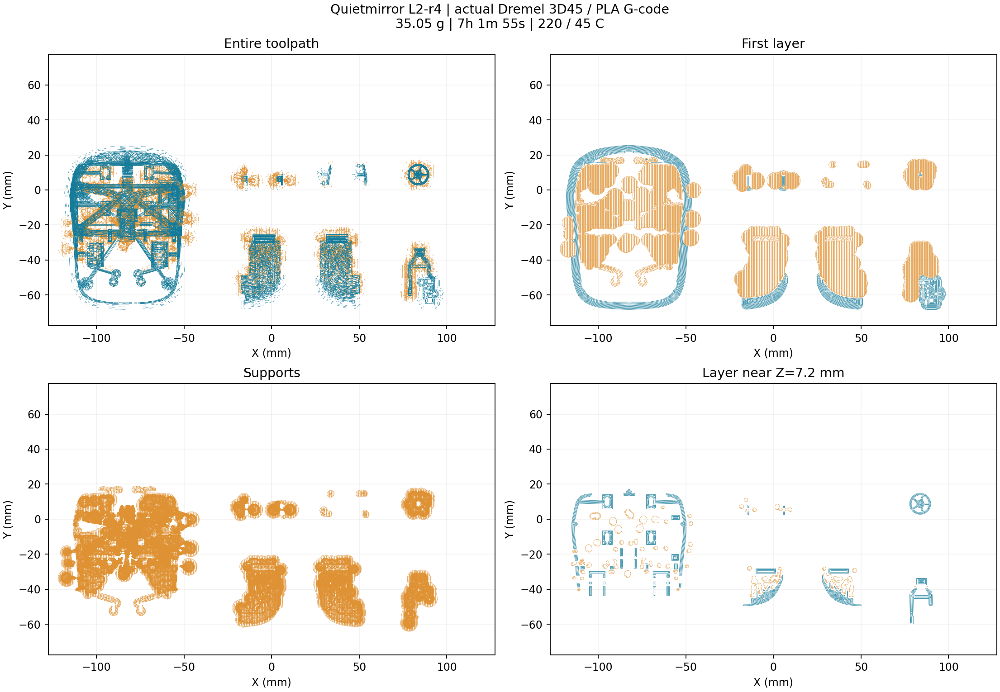

# Dremel 3D45 / PLA 切片文件

软件切片与校验完成；实机试印待完成。使用 0.4 mm 喷嘴、1.75 mm PLA、0.2 mm 层高、220°C / 45°C。

- **直接打印路径**：[L2_r4_3D45_PLA_PLATE.gcode](L2_r4_3D45_PLA_PLATE.gcode)
- **打开并调整工程**：[L2_r4_3D45_PLA_PLATE.3mf](L2_r4_3D45_PLA_PLATE.3mf)，目标软件 Dremel 3D Slicer 2.3.2。
- **整盘 STL**：[L2_r4_ALL_PARTS_PRINT_PLATE.stl](L2_r4_ALL_PARTS_PRINT_PLATE.stl)，九件已定向排盘，毫米、1:1。
- **整体 STL**：[L2_r4_WHOLE_ASSEMBLED_PRINTABLES.stl](L2_r4_WHOLE_ASSEMBLED_PRINTABLES.stl)，装配姿态的九个塑料件，用于查看外形；不能直接作为原位活动打印文件。

预计耗材 **35.05 g**，约 **7 小时 2 分钟**，含支撑与 brim。不要同时打印整盘和整体 STL，否则会重复打印并误把装配姿态当排盘。

[详细说明和复现方法](../../cad/l2_r4_3d45/README.md) · [实际验证数据](PRINT_VALIDATION.json) · [原 CAD / 单件 STL 与 STEP](../L2_r4/parts)

